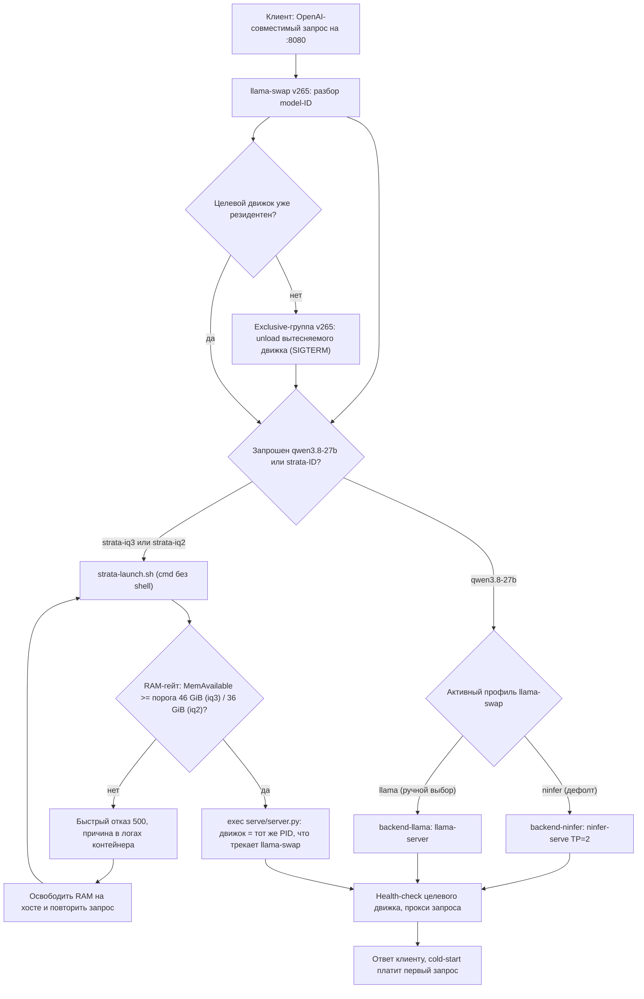

[Назад](../README.md)

# Схема работы роутера

Порядок unload -> start даёт дефолтная exclusive-группа llama-swap: старт
целевого движка начинается только после выхода вытесненных бэкендов, поэтому
RAM-гейт Strata видит реальные остатки памяти. Ручного шага переключения нет:
выбор model-ID в клиенте и есть переключение движка (ADR-0008).
