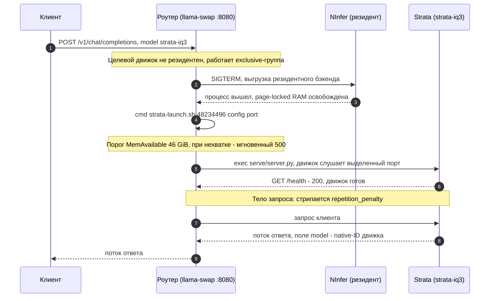

[Назад](../README.md)

# Последовательность запроса и автоматического свапа

Запрос к `strata-iq3`, когда резидентен NInfer (дефолтный старт контейнера).

Другие переходы (`iq3` на `iq2`, strata-ID на `qwen3.8-27b`) идут тем же
путём: выгрузка текущего движка, старт целевого, прокси запроса. Окна молчания
холодной загрузки (12-21 c у Strata, 7-9 c на тёплом page cache у llama.cpp,
до 40-60 c на холодном диске) при `sendLoadingState: false` не показываются
клиенту - индикатор только в логах контейнера (ADR-0006).
