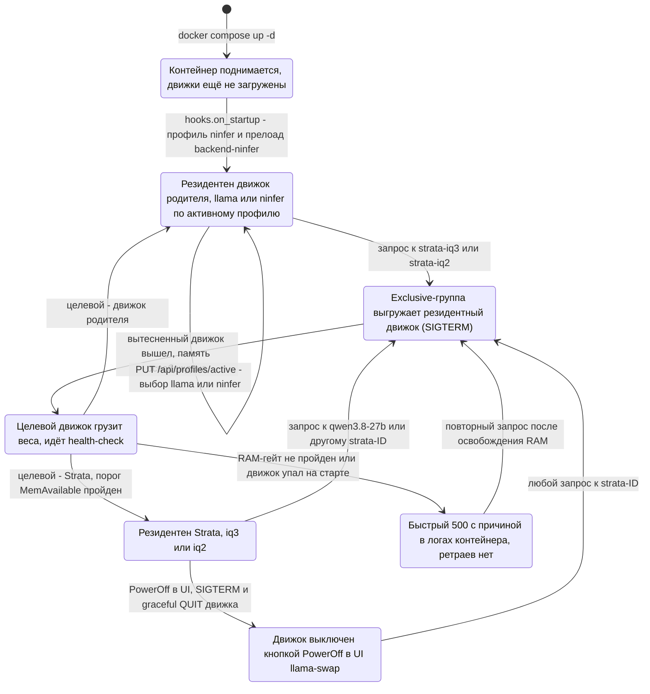

[Назад](../README.md)

# Состояния бэкендов роутера

Ровно один бэкенд резидентен в любой момент времени; переходы запускает сам
llama-swap по запросу к любому из трёх публичных ID (ADR-0008).

Единственный ручной переход — смена профиля родителя (`llama` или `ninfer`):
это предпочтение производительности, а не условие работоспособности. Профиль
сам движок не грузит, загрузку платит первый запрос к `qwen3.8-27b`.
